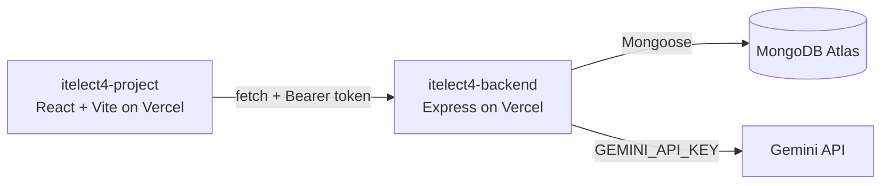

# ITELECT4 Backend

Express and TypeScript API for the ITELECT4 event and RSVP application. It uses MongoDB through Mongoose and is deployed on Vercel.

- **Live API:** [https://itelect4-backend-seven.vercel.app/api/health](https://itelect4-backend-seven.vercel.app/api/health)
- **Frontend App:** [https://itelect4-project-ten.vercel.app/](https://itelect4-project-ten.vercel.app/)
- **Frontend Repo:** [https://github.com/rivioops/itelect4-project](https://github.com/rivioops/itelect4-project)
- **Backend Repo:** [https://github.com/rivioops/itelect4-backend](https://github.com/rivioops/itelect4-backend)

## Architecture

## GT4 Part 1 — Express and Mongoose RSVP API

- Set up the Express API in TypeScript and connected it to MongoDB with Mongoose.
- Added User and RSVP models, including validation and safe JSON serialization that omits passwords and internal MongoDB fields.
- Added user registration and login. Passwords are hashed with bcrypt, and successful login returns a signed JWT.
- Added bearer-token authentication middleware and protected RSVP routes.
- Implemented RSVP create, list, get-by-ID, update, and delete operations. Users can access only their own RSVPs.
- Added a health endpoint, JSON parsing, CORS support, and centralized validation and error responses.
- Added local development, build, start, and type-check scripts, plus an `.env.example` for configuration.

## GT4 Part 2 — Events and Vercel deployment support

- Added an Event model, three reference events, and a seed script (`npm run seed`) that can be safely rerun.
- Added public event list and event-by-ID endpoints.
- Added request-time MongoDB connection middleware and cached the connection promise for serverless requests. Failed connections can be retried on later requests.
- Added an origin allowlist configured with `CORS_ORIGIN` for local and deployed frontend origins.
- Exported the Express app for Vercel serverless deployment.

## GT5 — Gemini AI review route

- Added `POST /api/ai`, a private route that asks Gemini to review a description of an event or RSVP and returns a structured result: `summary`, `highlights`, `suggestions` and `readiness` (`ready`, `almost` or `not-yet`).
- One Zod schema (`src/schemas/review.ts`) is the TypeScript type, the JSON Schema sent to Gemini, and the check on the reply. The request body is validated first, so a bad request costs no quota.
- The system prompt and two few-shot examples live in `src/ai/prompt.ts`. The user's text is wrapped in `<submission>` tags and treated as data to reduce prompt injection.
- The route requires a bearer token and is rate limited to 5 requests per minute per account. Failures return the API's own messages: 400 for a bad body, 429 for quota, 502 for a bad Gemini reply.
- `GEMINI_API_KEY` stays on the server (`.env` locally, Vercel settings when deployed) and is never sent to the browser.
- `npm run try-ai` sends one real request from the terminal to check the key, model and schema.

## GT6 — Testing and CI/CD

- Added Supertest and Vitest test suite (`tests/ai.test.ts`) covering the private `POST /api/ai` endpoint.
- Replaced database connection using `vi.mock("../src/config/db")` so backend integration tests run completely offline without waiting for MongoDB Atlas.
- Verified authentication enforcement: 401 when no token is passed, 401 when signed with an invalid secret, and 400 when a valid JWT token is provided with an invalid prompt (asserting schema validation stops bad requests before Gemini is contacted, conserving API quota).
- Configured GitHub Actions workflow (`.github/workflows/ci.yml`) to automatically install dependencies, type-check (`npm run typecheck`), and execute automated tests (`npm test`) on every push to any branch.
- Configured `JWT_SECRET` in GitHub Actions repository secrets for CI execution.

## API routes

| Method | Route | Access | Purpose |
| --- | --- | --- | --- |
| `GET` | `/api/health` | Public | Reports API and database status |
| `POST` | `/api/auth/register` | Public | Creates an attendee account |
| `POST` | `/api/auth/login` | Public | Authenticates and returns a JWT |
| `GET` | `/api/events` | Public | Lists events, ordered by date |
| `GET` | `/api/events/:id` | Public | Gets one event by its string ID |
| `GET` | `/api/rsvps` | Bearer token | Lists the signed-in user's RSVPs |
| `GET` | `/api/rsvps/:id` | Bearer token | Gets one of the signed-in user's RSVPs |
| `POST` | `/api/rsvps` | Bearer token | Creates an RSVP |
| `PATCH` | `/api/rsvps/:id` | Bearer token | Updates one of the signed-in user's RSVPs |
| `DELETE` | `/api/rsvps/:id` | Bearer token | Deletes one of the signed-in user's RSVPs |
| `POST` | `/api/ai` | Bearer token | Returns a Gemini review of an event or RSVP description; 5 requests per minute per account |

Send the JWT in the `Authorization` header for protected routes: `Authorization: Bearer <token>`. RSVP guest counts must be between 1 and 10; statuses are `pending`, `confirmed`, or `waitlisted`.

## Run locally

Requires Node.js and a MongoDB connection string.

1. Install dependencies with `npm install`.
2. Copy `.env.example` to `.env` and set `MONGODB_URI` and `JWT_SECRET`.
3. Set `CORS_ORIGIN` to the frontend origin, such as `http://localhost:5173` for local development. Multiple origins can be comma-separated.
4. Start the API with `npm run dev` (defaults to port `4000`).
5. Seed the reference events with `npm run seed` when setting up or repopulating the database.

Available scripts: `npm run dev`, `npm run build`, `npm start`, `npm run typecheck`, `npm run seed`, `npm run try-ai`, and `npm test`.

To use the AI route, create a key at [aistudio.google.com/apikey](https://aistudio.google.com/apikey) and set `GEMINI_API_KEY` in `.env`. Restart `npm run dev` after changing `.env`.
